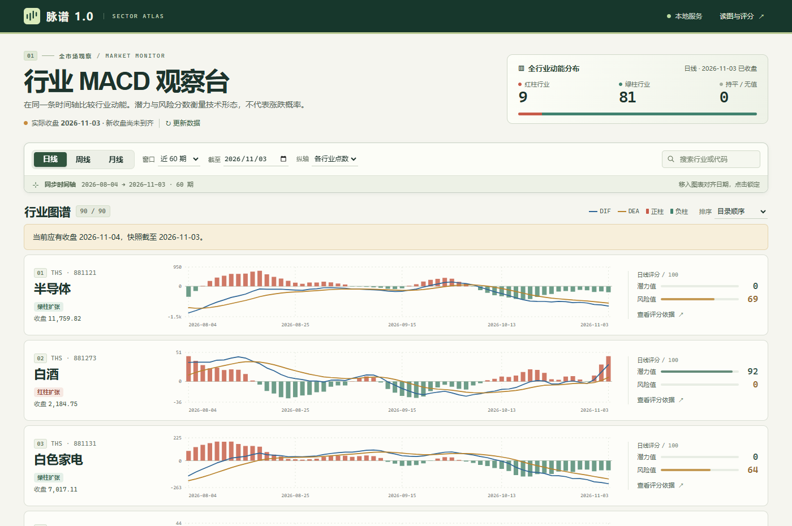

# 脉谱 1.0

本地运行的 A 股行业 MACD 观察台。第一版打包了同花顺 90 个行业的真实历史收盘价和可离线浏览的日、周、月 MACD 快照。

**现在打开：**双击同目录的「启动行业观察台.cmd」，或在服务运行时访问 <http://127.0.0.1:18916/>。如果只是查看保存的图，直接打开 `dist/index.html` 即可，不需要 Python 和网络。请保留旁边的 JS、CSS 文件。

[下载「脉谱 1.0」Windows 部署包](https://github.com/xiaoxiaoruiqiao-max/maipu-1.0/releases/tag/v1.0)：在 Assets 中选择 `maipu-1.0.zip`。仓库与版本包保存的是发布时的快照；安装在电脑上的程序会另行更新本机行情。

## 怎么比较

1. 选「日线」「周线」或「月线」。滚轮按网页正常上下滚动，每个行业一行。窗口可选 30 / 60 / 120 期，也可修改「截至」回看历史。
2. 移入任一图表，各行业的参考线会对齐到同一日期。点击锁定，然后上下滚动比较；按 Esc 解除。键盘聚焦图表后，也能用左右键选择日期，回车锁定。
3. 「各行业点数」保留原始 MACD 单位，各行纵轴分别缩放。要横向比较柱高，选「统一百分比」：各数值除以同期收盘再乘 100，所有行业使用同一纵轴。鼠标提示仍提供原始点数。
4. 可按行业名或代码查询，按潜力值或风险值排序。点击「查看评分依据」能看到日、周、月的对照表、三个周期的动能方向是否一致、实际 DIF / DEA / 柱值，以及两项分数逐项明细。

## 数据和分数

行业范围以[同花顺行业目录](https://q.10jqka.com.cn/thshy/)为准。数据取自相应的行业指数，而非成份股等权平均。每个行业的源地址、历史起点和末日保存在 `data/ths/行业代码.json`。例如：[半导体明文日线](https://d.10jqka.com.cn/v4/line/bk_881121/01/last.js)。交易日参考[深交所交易日历](https://www.szse.cn/api/report/exchange/onepersistenthour/monthList?month=2026-11)。

MACD 使用 12、26、9：DIF = EMA12 − EMA26，DEA = 对 DIF 取 EMA9，柱值 = 2 × (DIF − DEA)。连续满 26 期绘线，满 52 期评分。先用完整收盘历史预热，再截取网页数据；目前可回看最近 510 个交易日、300 个交易周、180 个交易月，个别行业成立较晚，成立前留空。日线缺失不补值，周/月使用对应周期最后一个交易日的真实收盘重新计算。未完结的周/月可勾选预览，不计入分数、动能分布和排序。

潜力值由零轴上方趋势（30）、正柱强度（25）、近三期动能改善（25）、最近五期金叉（20）相加。风险值由零轴下方趋势（25）、负柱强度（20）、近三期动能减弱（25）、最近五期死叉（15）、偏离较大且动能转弱（15）相加。两项分别计分，可以同时有分。各项强度与该行业前 26 期的常见幅度比较；网页「读图与评分」列出完整换算规则。它们描述已发生的技术变化，未经未来收益或最大回撤校准；0 风险分也不等于没有投资风险。

第一版核验：截至 2026-11-03，90 个行业共 372,370 条日收盘，最早 2007-08-01、最短自 2018-11-26。全行业各自的 140 根近期收盘与同花顺明文行情对照。另对半导体、养殖业、白酒、煤炭开采加工合计 3,359 个完整周和 789 个完整月做了独立期末行情核验，日期和点位均一致。详见 `data/ths-audit.json`。回看使用当前保存的历史价格以及当前行业名单，不是对当年行业分类或供应商历史修订版本的重建。

## 每天更新、迁移和排查

- 安装「每日更新」后，Windows 任务 `IndustryMACD-DailyClose-18916` 每天北京时间 **16:15** 检查应有交易日。网页关闭时也可执行；需要电脑可用、当前用户已登录、可访问行情源。关机、断网或错过时会在登录、重新启动服务或后续重试时补查。周末和休市日没有新的日收盘。
- 换电脑：把部署包完整解压到固定目录。要自动更新，安装 Python 3.9 或更新版本（加入 PATH），双击「安装每日更新.cmd」，再双击「启动行业观察台.cmd」。无须第三方 Python 包。移动目录后，重新运行安装脚本以更新任务路径。可在 Windows「任务计划程序」中停用该任务。
- 页面里的「更新数据」可手动触发同一流程；也可在项目目录执行 `python app.py update`。行情和页面快照均原子写入，全部抓取失败时保留旧图。当天收盘报价须在北京时间 15:35 后核对到源站当日 15:00 或之后的时间标记才纳入，绝不把盘中快照冒充日收盘。
- 查看状态：访问 <http://127.0.0.1:18916/api/status>，或打开 `data/update-status.json`；分行业更新结果在 `data/ths/refresh.json`。更新程序今天运行成功，也可能拿到的是上一个交易日的收盘，请以图中的「实际收盘」为准。
- 服务只绑定本机 127.0.0.1，无需账号、密钥或云端部署。macOS / Linux 上可以使用 `python3 app.py serve` 访问相同地址；Windows 计划任务脚本仅用于 Windows。
